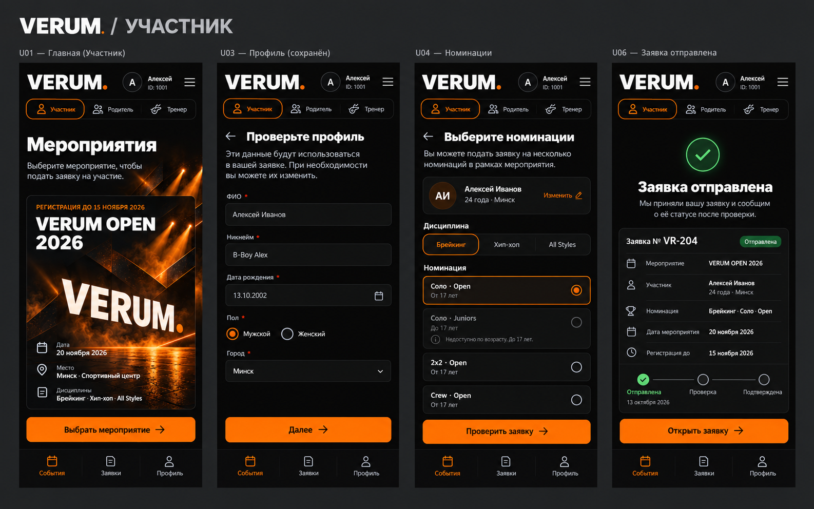
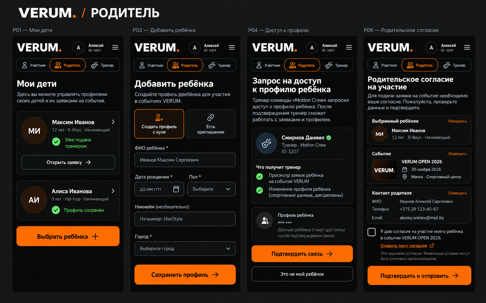
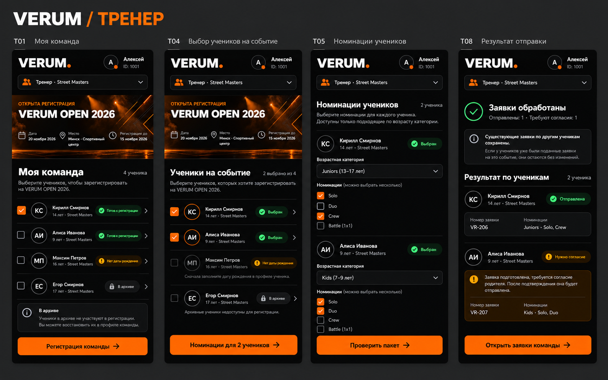
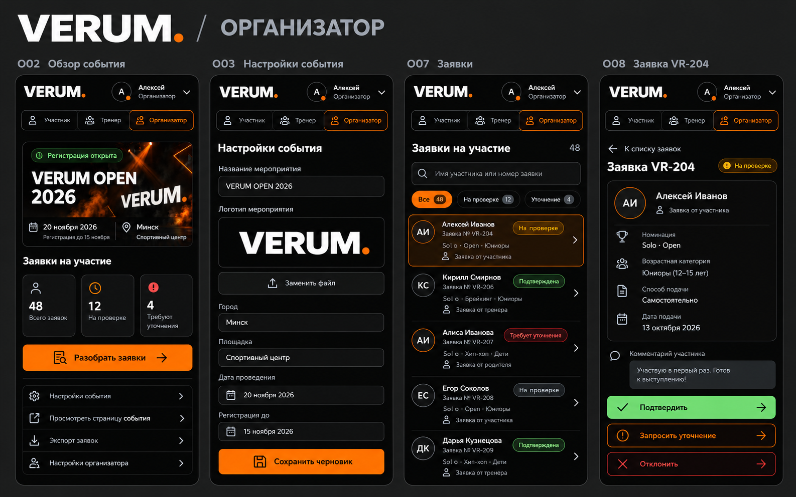
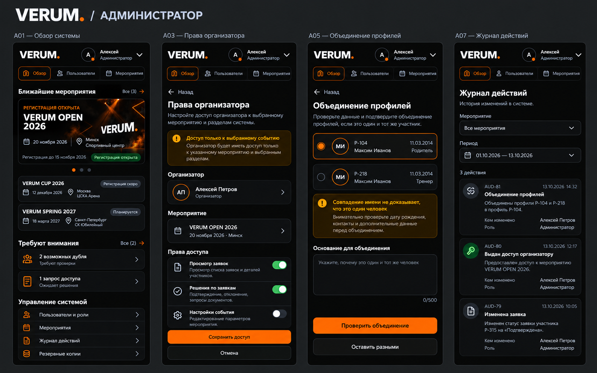
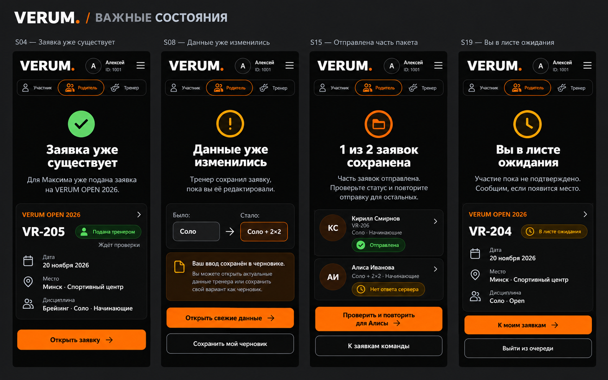

# VERUM — 89 экранов нового интерфейса

Дизайн от 13 октября 2026. Пять ролей: участник, родитель, тренер, организатор, администратор. Все данные в макетах вымышлены.

**Это дизайн и спецификация. Рабочие боты, сервер и база этим альбомом не изменены.**

## Как открыть

Скачайте репозиторий или эту папку целиком и откройте [index.html](index.html) в браузере. Установка, сервер, npm и внешние шрифты не нужны. Интернет для самого альбома тоже не требуется. Не скачивайте только HTML: рядом нужны JS, CSS, assets и boards.

В альбоме:

- **Экран** — отдельный макет с полями, кнопками, правилами и переходами.
- **Все** — все 89 макетов; фильтр по роли и поиск по названию/ID/правилу.
- **Визуалы** — шесть больших иллюстрированных листов; клик открывает изображение крупно.
- Содержимое телефона прокручивается; основные действия остаются снизу.
- Нажатия открывают демонстрационные состояния, а не отправляют реальные заявки. Заполненные поля не сохраняются.
- Для печати выбрать «Все» и напечатать страницу. Проверка полного печатного экспорта в PDF отдельно не проводилась.

## Комплект

| Раздел | Экраны | Количество |
|---|---|---:|
| Вход, роли, уведомления, данные, приглашения | C01–C11 | 11 |
| Участник: событие, профиль, номинации, заявка | U01–U11 | 11 |
| Родитель: дети, связи, согласия | P01–P10 | 10 |
| Тренер: состав, пакет, результат, экспорт | T01–T12 | 12 |
| Организатор: события, заявки, правила, уведомления | O01–O14 | 14 |
| Администратор: права, совпадения, журнал, копии | A01–A12 | 12 |
| Ошибки, пустые состояния, отмена, конфликт, очередь | S01–S19 | 19 |

[Подробная спецификация логики и дизайна](SPEC.md) · [Исходный каталог экранов](screens.js) · [Результаты проверки](QA.md) · [Промпты генерации](IMAGE-PROMPTS.md) · [Передача проекта на другой компьютер](../HANDOFF.md).

## Основная логика

Один человек — один постоянный профиль. Родитель и тренер получают подтверждённый доступ к нему. На событие используется одна заявка человека с несколькими номинациями. Совпадение имени не означает автоматическое объединение. Повторная отправка и конфликт одновременных изменений обрабатываются отдельно.

В текущем коде эти правила реализованы не полностью. Альбом описывает целевое поведение; перечень пробелов — в спецификации.

## Визуальные листы

Листы созданы ImageGen по принятому чёрно-оранжевому направлению с настоящим логотипом VERUM. На генерациях возможны неточные подписи/категории. Источник истины для разработки — **HTML-экраны и SPEC.md**.

### 01 · Участник

### 02 · Родитель

### 03 · Тренер

### 04 · Организатор

### 05 · Администратор

### 06 · Состояния

## Продолжение работы

Ветка: `cloudflare-workers`. Папка: `design/atlas/`. Для проверки структуры выполнить `node design/atlas/validate.cjs` из корня репозитория. Изменения этого комплекта не требуют деплоя рабочего приложения.

Следующий этап — реализация общей модели людей/связей/заявок и серверных прав, затем подключение экранов. Не переносить сгенерированные картинки в качестве формы: все элементы должны быть настоящим интерфейсом.
